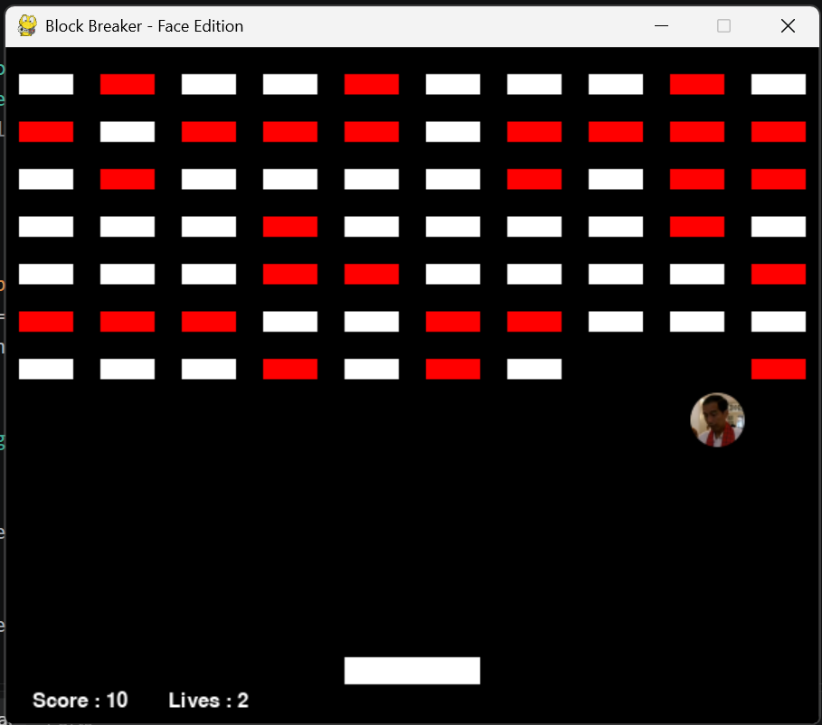

# Modify Game Brick Breaker - Face Edition

Modifikasi game Brick Breaker (Block Breaker) berbasis **Python + pygame**. Bola yang awalnya lingkaran putih diganti menjadi **muka**, yang berubah ekspresi menjadi **kaget** disertai **sound effect** setiap kali mengenai blok.

## Perbandingan Sebelum dan Sesudah

| Aspek | Sebelum (default) | Sesudah (modifikasi) |
|-------|-------------------|----------------------|
| Tampilan bola | Lingkaran putih, radius 7 | Gambar muka, radius 20 |
| Saat kena blok | Tidak ada efek visual | Muka berganti ke ekspresi kaget (~0,27 detik) lalu kembali normal |
| Suara | Tidak ada | Sound effect "uh kaget" saat kena blok |
| Asset | Tidak ada | Folder `assets/` (2 gambar + 1 sound) |
| Asset hilang | - | Game tetap jalan (bola lingkaran biasa, tanpa suara) |
| Judul window | Block Breaker | Block Breaker - Face Edition |

## Daftar Perubahan pada Kode

Setiap perubahan ditandai komentar `# -- [BARU]` (fitur baru) atau `# -- [UBAH]` (kode asli yang diubah) di `main.py`.

1. **[BARU] Load asset**: fungsi `loadFace()` dan `loadSound()` dengan fallback jika file tidak ditemukan.
2. **[BARU] Ekspresi muka** di class `Ball`: atribut `faceNormal`, `faceShock`, `shockTimer`, dan method `shock()`.
3. **[UBAH] `Ball.display()`**: menggambar gambar muka (normal atau kaget), bukan lingkaran.
4. **[UBAH] `Ball.update()` dan `Ball.reset()`**: timer muka kaget berkurang tiap frame dan di-reset saat bola reset.
5. **[BARU] Sound effect** diputar saat bola kena blok.
6. **[UBAH] Radius bola** dari 7 menjadi 20 agar muka terlihat jelas.
7. **[UBAH] Perbaikan tabrakan** (akibat bola lebih besar):
   - Bola dipantulkan satu kali per frame walau menyentuh beberapa blok sekaligus, supaya tidak tembus blok.
   - Striker hanya memantulkan bola yang sedang turun, supaya bola tidak nyangkut di striker.
8. **[UBAH] Judul window**.

## Cara Menjalankan

```bash
pip install pygame
python main.py
```

## Kontrol

| Tombol | Fungsi |
|--------|--------|
| Panah kiri / kanan | Menggerakkan striker |
| SPACE | Main lagi saat game over |

## Struktur Folder

```
ModifyGameBrickBreaker_XXX/
├── main.py
├── README.md
└── assets/
    ├── face_normal.png   # muka bola saat normal
    ├── face_shock.png    # muka bola saat kena blok
    └── uh_kaget.wav      # sound effect saat kena blok
```

## Credit

- Kode dasar: game Brick Breaker (pygame) dari materi praktikum.
- Modifikasi: gambar muka, sistem ekspresi, sound effect, dan perbaikan tabrakan.
- Asset gambar dan suara: koleksi pribadi untuk keperluan tugas kuliah.
